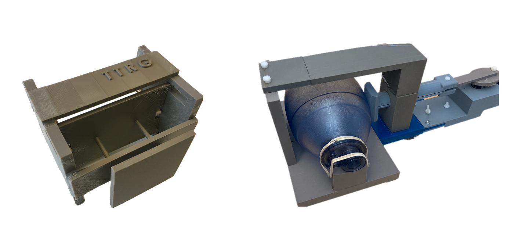
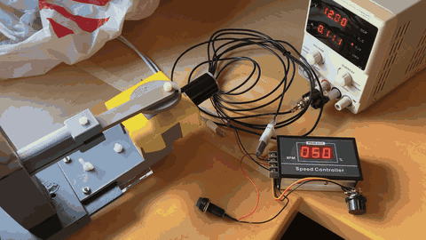
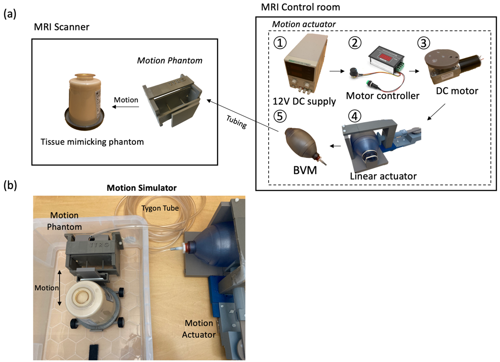
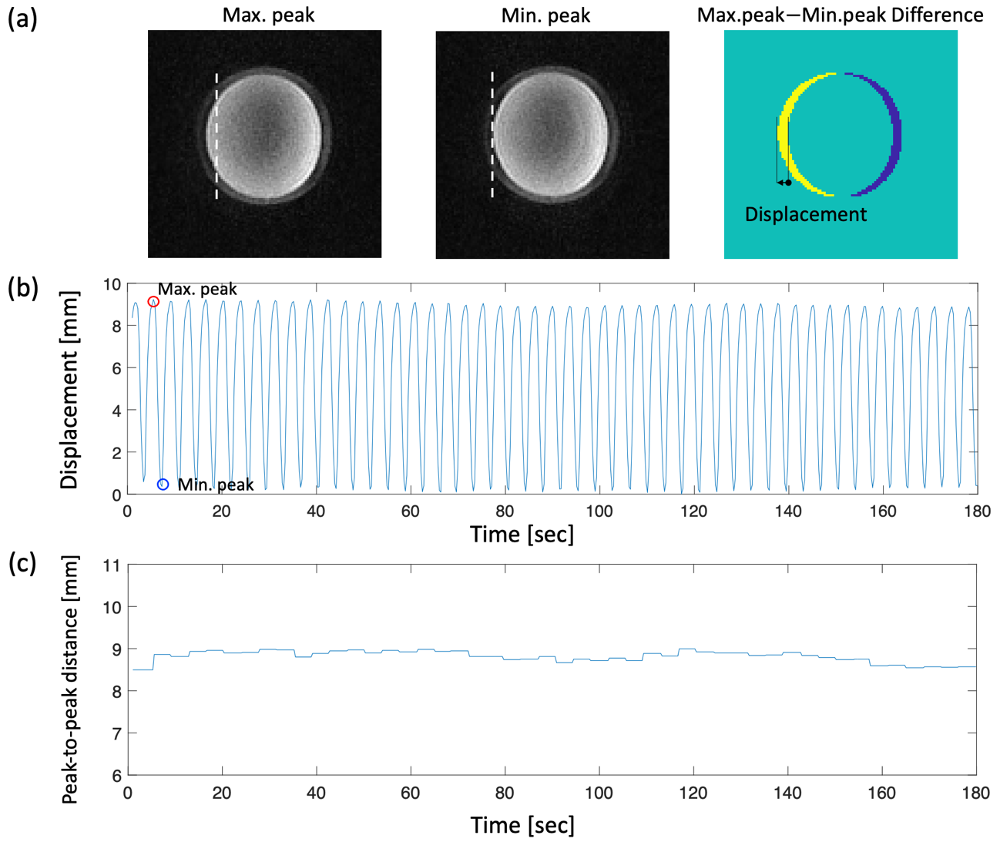
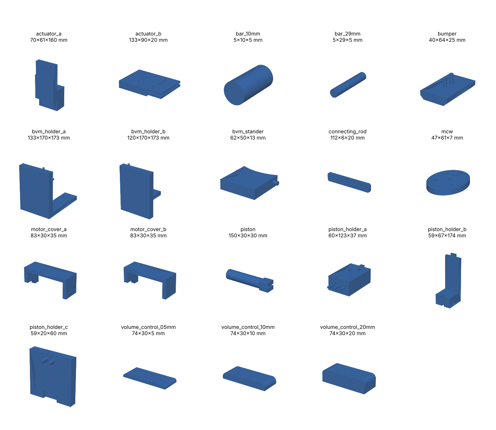
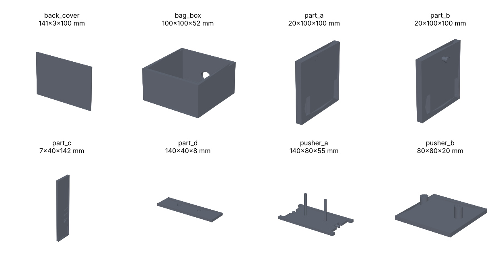

<div align="center">

# Respiratory Motion Phantom

**A low‑cost (≈ $257), MR‑compatible, pneumatic respiratory organ motion simulator for MR‑guided thermal therapy and motion‑robust MRI development**

[](https://doi.org/10.1002/mp.15783)
[](https://pubmed.ncbi.nlm.nih.gov/35635215/)
[](https://www.ncbi.nlm.nih.gov/pmc/articles/PMC9288488/)
[%3A4365--4371-2E5899)](https://doi.org/10.1002/mp.15783)
[](LICENSE)
[](hardware/)



</div>

> **📌 If you use this design, please cite our paper** (see [How to cite](#-how-to-cite)).
> Kim K, Jones P, Diederich C, Ozhinsky E. *Technical note: Low‑cost MR‑compatible pneumatic respiratory organ motion simulator for the development of MR‑guided thermal therapy.* **Medical Physics** 2022;49(7):4365–4371. [doi:10.1002/mp.15783](https://doi.org/10.1002/mp.15783)

---

## Why this phantom?

Respiratory motion is the dominant source of abdominal organ motion and a major source of error in **proton resonance frequency (PRF) MR thermometry** and in **MR‑guided focused ultrasound (MRgFUS)** targeting. Commercial dynamic motion phantoms are expensive, and custom phantoms described in the literature rarely include enough detail to be reproduced.

This repository provides everything needed to build a respiratory motion simulator from **3D‑printed parts and off‑the‑shelf components**:

| | |
|---|---|
| **Cost** | ≈ $257 in total (≈ 1.4 kg ABS + off‑the‑shelf parts) |
| **MR safety** | Phantom inside the bore is fully non‑metallic (3D‑printed ABS, rubber bands, epoxy). All electronics stay in the control room. |
| **Drive** | Pneumatic: DC motor → linear actuator → bag valve mask (BVM) → Tygon tubing → inflatable bag in the phantom |
| **Respiratory rate** | 8–16 breaths/min (PWM speed controller) |
| **Displacement** | 3.7–9 mm peak‑to‑peak (superior–inferior), selected with interchangeable volume control plates |
| **Payload** | Tissue‑mimicking HIFU phantom, 1.2 kg |
| **Validated on** | 3T MRI (GE Healthcare) with real‑time spiral GRE + pencil‑beam navigator (RTHawk); no interference with MRI acquisition |
| **MRgFUS compatible** | Wheeled ring holder with a central opening for the ultrasound beam path from a table‑integrated transducer |
| **Software** | None required |

## Demo

<div align="center">

[](media/actuator_demo.mp4)

*Motion actuator running (12 V, 16 rpm DC gear motor with PWM speed controller). Click for the MP4.*

</div>

## How it works

<div align="center">

</div>

1. **Motion actuator (control room):** a 12 V DC gear motor drives a 3D‑printed crank and piston (linear actuator) that periodically compresses a 1.8 L bag valve mask (BVM).
2. **Pneumatic line:** the BVM is coupled to the scanner room through flexible Tygon tubing.
3. **Motion phantom (MRI bore):** the inflatable bag inside the phantom pushes a 10 × 10 cm plate; rubber bands supply the passive return force. The tissue‑mimicking phantom on the wheeled holder moves along the bore axis, mimicking diaphragm‑driven organ shift.
4. **Amplitude control:** volume control plates (5, 10, 20 mm; stackable) are inserted between the BVM and the piston to set the compression volume and hence the displacement.

## Performance

Averaged peak‑to‑peak displacement over 3 min at 16 breaths/min ([User Manual](docs/User_Manual_v2.docx), Table 1):

| BVM volume / added plate thickness | Displacement (mm) |
|---|---|
| 1.75 L / 10 mm | 5.0 ± 0.1 |
| 1.70 L / 30 mm | 7.0 ± 0.1 |
| 1.65 L / 35 mm | 8.8 ± 0.1 |

<div align="center">

</div>

## Repository contents

```
respiratory-motion-phantom/
├── hardware/
│   ├── motion-actuator/     # 20 STL files (control-room side)
│   └── motion-phantom/      #  8 STL files (MRI-bore side, non-metallic)
├── docs/
│   ├── ASSEMBLY.md          # Step-by-step build guide
│   ├── BOM.csv              # Bill of materials with costs
│   ├── User_Manual_v2.docx  # Original user manual
│   ├── images/              # Figures and part previews
│   └── paper/               # Author accepted manuscript (Med Phys 2022)
├── media/                   # Demo video (MP4, GIF, original MOV)
├── CITATION.cff             # Machine-readable citation ("Cite this repository")
└── LICENSE                  # CC BY 4.0
```

GitHub renders every `.stl` file as an interactive 3D viewer, so you can inspect each part before printing.

### Motion actuator parts



### Motion phantom parts



## Quick start

1. **Print** all parts in [`hardware/`](hardware/) in ABS (Zortrax M200 Plus was used; ≈ 1.4 kg filament).
2. **Buy** the off‑the‑shelf components listed in [`docs/BOM.csv`](docs/BOM.csv).
3. **Assemble** following [`docs/ASSEMBLY.md`](docs/ASSEMBLY.md). Use non‑magnetic epoxy for the phantom.
4. **Connect** the BVM to the phantom bag with Tygon tubing (15 ft reaches from the control room through the waveguide).
5. **Run** at 12 V and set the respiratory rate (8–16 /min) on the PWM controller; choose a volume control plate for the desired amplitude.

## Applications

1. Development and validation of **motion‑robust PRF MR thermometry** (multibaseline, referenceless, navigator‑gated)
2. **MRgFUS / MR‑HIFU** targeting and beam‑steering studies in moving organs (liver, kidney, pancreas)
3. **4D MRI**, motion‑resolved reconstruction, and navigator sequence testing
4. Respiratory gating and motion compensation in **MR‑guided hyperthermia** and ablation
5. Teaching and QA demonstrations of motion artifacts in MRI

## 📖 How to cite

If this design, the STL files, or the data help your work, **please cite the paper**:

> Kim K, Jones P, Diederich C, Ozhinsky E. Technical note: Low‑cost MR‑compatible pneumatic respiratory organ motion simulator for the development of MR‑guided thermal therapy. *Medical Physics*. 2022;49(7):4365–4371. doi:[10.1002/mp.15783](https://doi.org/10.1002/mp.15783). PMID: 35635215; PMCID: PMC9288488.

```bibtex
@article{Kim2022RespiratoryMotionSimulator,
  author  = {Kim, Kisoo and Jones, Peter and Diederich, Chris and Ozhinsky, Eugene},
  title   = {Technical note: Low-cost {MR}-compatible pneumatic respiratory organ motion simulator for the development of {MR}-guided thermal therapy},
  journal = {Medical Physics},
  year    = {2022},
  volume  = {49},
  number  = {7},
  pages   = {4365--4371},
  doi     = {10.1002/mp.15783},
  pmid    = {35635215},
  pmcid   = {PMC9288488}
}
```

You can also click **"Cite this repository"** in the right sidebar of this page (generated from [`CITATION.cff`](CITATION.cff)).

## Related work from our group

1. Kim K, Narsinh K, Ozhinsky E. Technical advances in motion‑robust MR thermometry. *Magnetic Resonance in Medicine*. 2024;92(1):15–27. [doi:10.1002/mrm.30057](https://doi.org/10.1002/mrm.30057)
2. Kim K, Diederich C, Narsinh K, Ozhinsky E. Motion‑robust, multi‑slice, real‑time MR thermometry for MR‑guided thermal therapy in abdominal organs. *International Journal of Hyperthermia*. 2023;40(1):2151649. [doi:10.1080/02656736.2022.2151649](https://doi.org/10.1080/02656736.2022.2151649)

## Other open‑source projects from MIGT Lab

1. [SparseArrayTransducerDesign](https://github.com/MIGT-Lab/SparseArrayTransducerDesign): sparse spherical‑cap phased array layout generator for low‑intensity transcranial focused ultrasound (MATLAB and Python)

## Acknowledgments

Developed by the Thermal Therapy Research Group, University of California, San Francisco. Supported by NIH grants R21EB026018, R01EB025990, and R21CA230120. The design was originally released at `github.com/mri-kisoo/RespiMotionSimulator` (reference 19 in the paper) and is now maintained here by the **Medical Imaging Guided Therapy (MIGT) Lab, Kyung Hee University**.

## License

Hardware designs, documentation, and media are released under the [Creative Commons Attribution 4.0 International License (CC BY 4.0)](LICENSE). You are free to use, modify, and redistribute them, including commercially, **provided you give appropriate credit by citing the paper above**. The manuscript in `docs/paper/` is the author accepted manuscript; the version of record is available from the publisher at [doi:10.1002/mp.15783](https://doi.org/10.1002/mp.15783).

## Contact

**Kisoo Kim, Ph.D.**, Assistant Professor, Department of Biomedical Engineering, Kyung Hee University
Medical Imaging Guided Therapy (MIGT) Lab · [migt.khu.ac.kr](https://migt.khu.ac.kr) · kisoo.kim@khu.ac.kr

Questions, build reports, and improvements are welcome through [Issues](../../issues) and pull requests. If you build one, we would love to see a photo.

<sub>Keywords: respiratory motion phantom, MR‑compatible motion simulator, abdominal organ motion, MR thermometry, PRF thermometry, MRgFUS, MR‑HIFU, focused ultrasound, hyperthermia, motion compensation, 4D MRI, navigator, 3D printing, open hardware, low‑cost phantom</sub>
