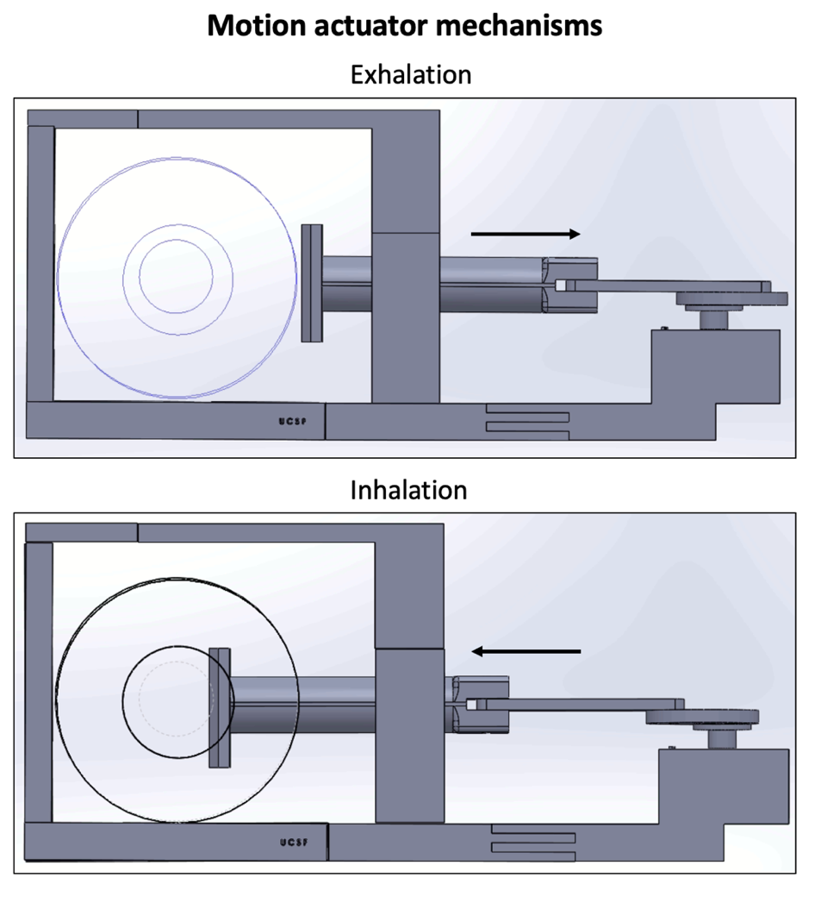
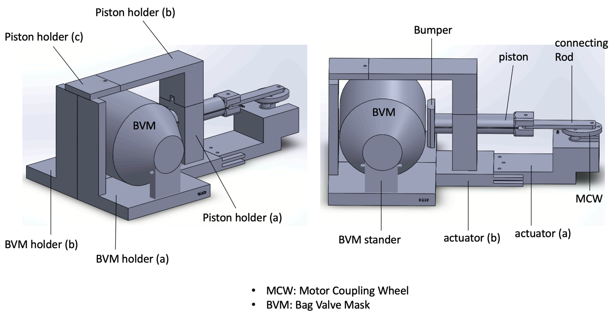
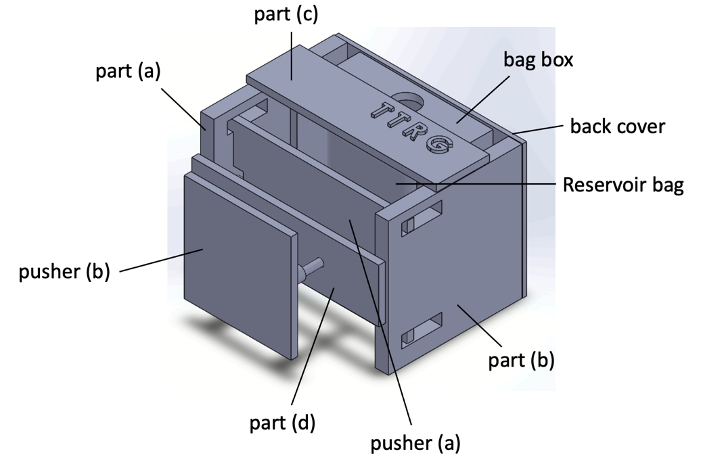
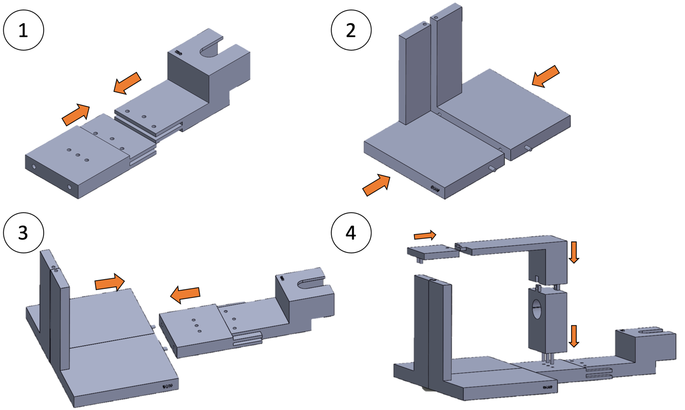
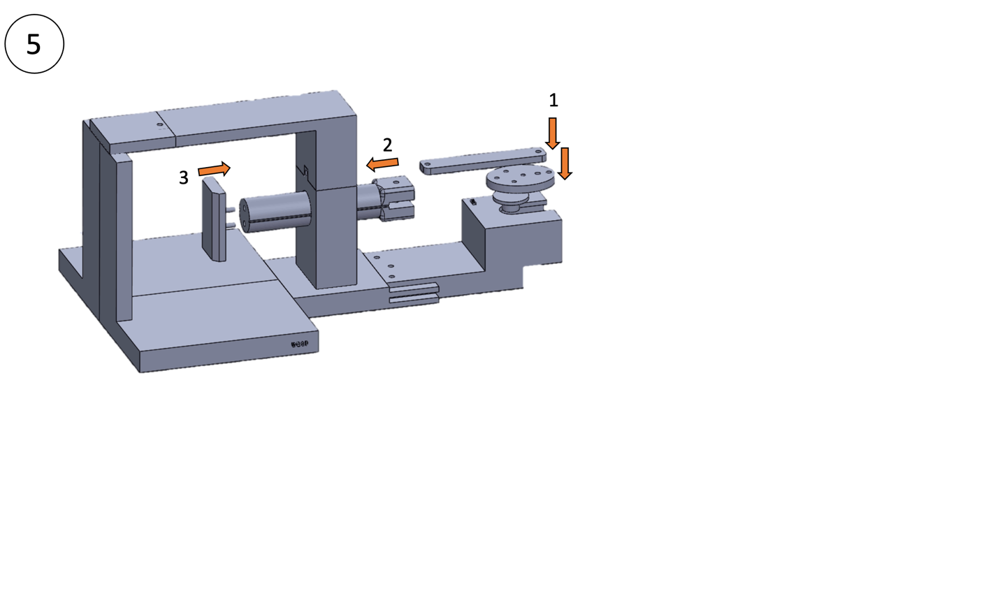
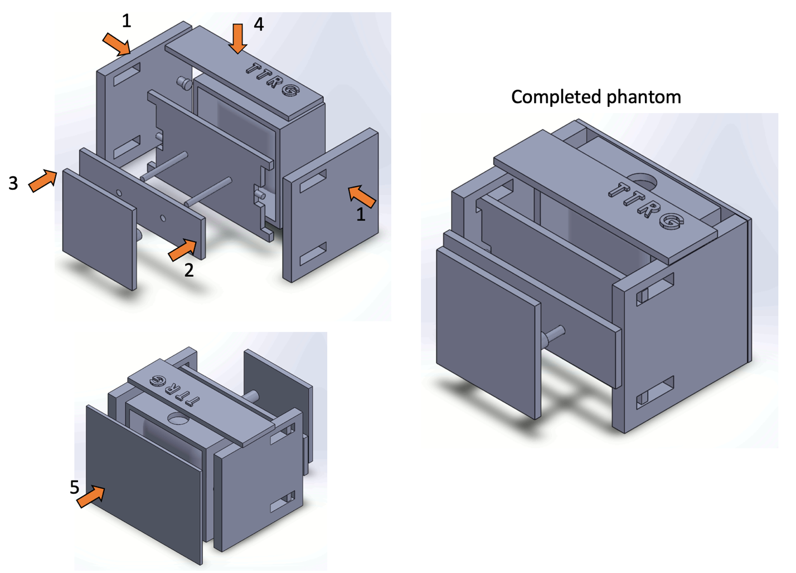

# Assembly Guide

Adapted from the [User Manual](User_Manual_v2.docx) (UCSF Thermal Therapy Research Group, updated 03/19/2022). Please cite [Kim et al., Med Phys 2022](https://doi.org/10.1002/mp.15783) when using this design.

## 1. Overview

Outside the MRI suite, a 16 rpm DC motor drives a motion actuator that periodically compresses a bag valve mask (BVM). The BVM is coupled via Tygon tubing to an inflatable bag in the motion phantom inside the scanner. Inflation and deflation of the bag move a tissue‑mimicking phantom cyclically along the bore axis, simulating respiratory shift of abdominal organs. The PWM controller sets the rate between 8 and 16 cycles/min.

## 2. Printed parts

All parts were printed in ABS on a Zortrax M200 Plus.

### Motion actuator (`hardware/motion-actuator/`)

| File | Part (manual name) | Weight | Qty |
|---|---|---|---|
| `mcw.stl` | Motor connector coupling wheel (MCW) | 12 g | 1 |
| `connecting_rod.stl` | Connecting rod | 10 g | 1 |
| `piston.stl` | Piston | 53 g | 1 |
| `piston_holder_a.stl` | Piston holder (a) | 83 g | 1 |
| `piston_holder_b.stl` | Piston holder (b) | 110 g | 1 |
| `piston_holder_c.stl` | Piston holder (c) | 24 g | 1 |
| `bumper.stl` | Bumper | 15 g | 1 |
| `actuator_a.stl` | Actuator (a) | 170 g | 1 |
| `actuator_b.stl` | Actuator (b) | 122 g | 1 |
| `bvm_stander.stl` | BVM stander | 16 g | 1 |
| `bvm_holder_a.stl` | BVM holder (a) | 227 g | 1 |
| `bvm_holder_b.stl` | BVM holder (b) | 227 g | 1 |
| `motor_cover_a.stl`, `motor_cover_b.stl` | Motor cover (a), (b) | | 1 each |
| `bar_10mm.stl` | Fixing bar, 10 mm | | 3 |
| `bar_20mm.stl` | Fixing bar, 20 mm | | 3 |
| `bar_29mm.stl` | Fixing bar, 29 mm | | 1 |
| `volume_control_05mm.stl`, `_10mm`, `_20mm` | Volume control plates (stackable) | | 1 each |

`bar_20mm.stl` is the 10 mm bar extended to 20 mm (same 4.8 mm diameter).

### Motion phantom (`hardware/motion-phantom/`)

| File | Part (manual name) | Weight |
|---|---|---|
| `part_a.stl` | Part (a) | 50 g |
| `part_b.stl` | Part (b) | 50 g |
| `part_c.stl` | Part (c) | 21 g |
| `part_d.stl` | Part (d), chamfered version (03/10/2022) for more stable movement | 22 g |
| `pusher_a.stl` | Pusher (a) | 38 g |
| `pusher_b.stl` | Pusher (b) | 25 g |
| `back_cover.stl` | Back cover | 39 g |
| `bag_box.stl` | Bag box (holds the inflatable bag) | 75 g |

## 3. Assembly

### Motion actuator

Fix the components with the printed bars at the following steps:

1. Step 1: three 20 mm bars
2. Step 4: two 10 mm bars
3. Step 5: one 29 mm bar and one 10 mm bar (**do not use epoxy** at this step)

Elsewhere, fix the bars with epoxy. Epoxy was chosen for its high bond strength, non‑magnetic composition, and water resistance.

### Motion phantom

Fix the components and bars with epoxy. Place the BVM reservoir bag in the bag box, attach rubber bands to provide the return force, and connect the bag to the BVM with Tygon tubing.

## 4. Setting the amplitude

Insert volume control plates between the BVM and the piston. Plates can be stacked (5 + 10 + 20 mm).

| BVM volume / added plate thickness | Peak‑to‑peak displacement at 16 /min (mm) |
|---|---|
| 1.75 L / 10 mm | 5.0 ± 0.1 |
| 1.70 L / 30 mm | 7.0 ± 0.1 |
| 1.65 L / 35 mm | 8.8 ± 0.1 |

The displacement depends on the BVM volume and is similar across respiratory rates of 8 to 16 cycles/min.

## 5. MRI setup

1. Keep the power supply, controller, motor, and actuator in the control room.
2. Route the Tygon tubing through the waveguide to the phantom on the scanner table.
3. For MRgFUS, place the phantom in a water‑filled plastic container with an acoustic membrane on the bottom, over the table transducer.

